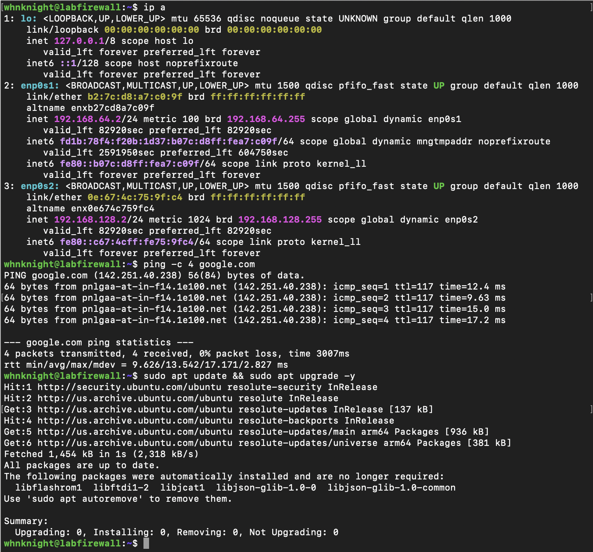

# Segmented Network & Firewall Lab

*A virtualized Linux firewall with inside/outside segmentation, built and documented on an M1 Mac using UTM and Ubuntu Server.*

## Environment & Setup 

Built in UTM on an M1 MacBook.
VM: Ubuntu Server 26.04.1 LTS (ARM64), 2 GB RAM, 2 CPU cores, 20 GB disk, with an initial Shared Network adapter.

All screenshots captured from the Terminal interface.

**Date:** 21 November 2026

---

## Goal 1: Build the VM, verify connectivity, apply updates, add a second network adapter

> **Note from the author:** The screenshots in this section verify the success of the listed commands. They were captured after the processes were completed.

### Command: `ip a`

**Purpose:** Lists every network interface on the VM and the addresses assigned to it.  
**Breakdown:** `ip` is the Linux networking tool, and `a` is short for `address`, so it shows address information.  
**Result:**

* `lo` (loopback): 127.0.0.1/8, used for the machine talking to itself.
* `enp0s1` (outside, Shared Network): 192.168.64.2/24, state UP, address marked `dynamic`.
* `enp0s2` (inside, Host Only): 192.168.128.2/24, state UP, address marked `dynamic`.

**Conclusion:** The VM is dual-homed, with an interface on each of two separate subnets. Both addresses are DHCP-assigned (`dynamic`), so the inside address isn't permanent yet.

### Command: `ping -c 4 google.com`

**Purpose:** Sends four ICMP echo requests to test DNS resolution and outbound internet connectivity.  
**Breakdown:** `ping` sends test packets and waits for replies; `-c 4` stops after four packets; `google.com` is the destination, which tests DNS resolution and internet reachability together.  
**Result:** Four replies received, 0% packet loss.  
**Conclusion:** The VM can resolve domain names and reach the internet, confirming the network configuration works.

### Command: `sudo apt update && sudo apt upgrade -y`

**Purpose:** `apt update` refreshes the package list; `apt upgrade -y` installs available updates without prompting.  
**Breakdown:** `sudo` runs the command as administrator; `apt` is Ubuntu's package manager; `update` downloads the latest package lists; `upgrade` installs newer versions; `-y` answers the confirmation prompt automatically; `&&` runs the second command only if the first succeeds.  
**Result:** Updates installed successfully. Several services (e.g., networkd-dispatcher, systemd-logind) had restarts deferred until the next reboot.  
**Conclusion:** A reboot was needed for all services to run their updated versions, so I shut the VM down cleanly with `sudo shutdown now`.

*`ip a`, `ping -c 4 google.com`, and `apt update && apt upgrade -y`, run after the updates were complete. Both interfaces are UP, the ping shows 4 of 4 replies with 0% loss, and apt reports nothing left to upgrade.*

---

## Troubleshooting: Root filesystem smaller than the virtual disk

**Problem:** Root filesystem showed 9.75 GB on a 20 GB virtual disk (53.8% used).  
**Diagnosis:** `sudo vgs` showed about 7.3 GB free in the volume group, because the installer's default LVM layout doesn't allocate the whole disk.  
**Fix:** `sudo lvextend -r --extents +100%FREE /dev/ubuntu-vg/ubuntu-lv`  
**Breakdown:** `lvextend` grows a logical volume; `-r` also resizes the filesystem on it; `--extents +100%FREE` uses all remaining free space; the last argument is the volume's path.  
**Verification:** Immediately after the fix, `df -h /` showed 17 GB total, 11 GB available, 33% used. The verification screenshot below was taken later and shows 12 GB available, 29% used.  
**Conclusion:** The default install left roughly half of the disk unused. Expanding the volume gave the firewall VM headroom for logs, packages, and tooling, and the process confirmed how to read and extend LVM storage.

*`df -h /` after the fix: the root filesystem is 17 GB.*
